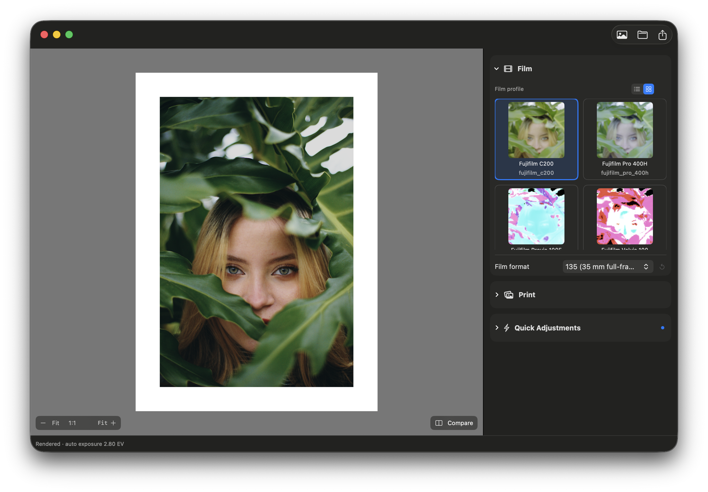

# Spektrafilm SwiftUI



A native macOS film-simulation app built with SwiftUI, Swift 6, and Metal.
This is a Swift port of the [spektrafilm](https://github.com/andreavolpato/spektrafilm)
pipeline (original Python and Rust implementations), rendering a photographic
image through the full analog film chain: **filming → developing → printing →
paper → scanning**.

## Overview

Spektrafilm SwiftUI takes a digital photograph (RAW or standard image) and
simulates the optical and chemical behavior of a film stock and photo paper:
spectral sensitivity, density curves, DIR couplers, halation, grain, diffusion,
enlarger filtering, and scanner response. A single Metal compute graph drives
the interactive preview, with a CPU reference path used for headless rendering
and parity tests.

## Features

- Import RAW, JPEG, PNG, and TIFF sources, with RAW white-balance, tint, and exposure controls
- Choose film and print (paper) profiles independently, or scan the negative directly
- Live, GPU-resident Metal preview with zoom, pan, and cached stage reuse
- Film adjustments: density-curve gamma, DIR couplers, halation, grain, diffusion, lens blur
- Enlarger controls: C/M/Y filters, exposure, pre-flash, normalization, diffusion
- Scanner controls: lens blur, unsharp mask, white/black correction, output color space
- Export to JPEG, TIFF (8/16-bit, LZW/Deflate), and PNG (8/16-bit, Adam7)

## Requirements

- macOS 14 (Sonoma) or later
- Xcode 16 or later (Swift 6 toolchain)
- A Metal-capable Mac for GPU-accelerated preview and export

## Getting started

Clone with the upstream reference submodule:

```bash
git clone --recurse-submodules https://github.com/stnKrisna/spektrafilm-macos.git
cd spektrafilm-macos

# if the repository was already cloned without submodules:
git submodule update --init --recursive
```

The upstream Python reference is vendored as the `ThirdParty/spektrafilm`
submodule and is only needed to run the golden-parity test.

Fetch the Spektrafilm profile/LUT data pack (see [Data & credits](#data--credits)):

```bash
Scripts/fetch-data.sh 0.3.3
```

Build and test with Swift Package Manager:

```bash
swift build
swift test
```

Run the macOS app:

```bash
swift run SpektrafilmApp
```

Or open the Xcode project for the full app and UI-test suites:

```bash
open "xcode/Spektrafilm MacOS/Spektrafilm MacOS.xcodeproj"
```

## Testing

```bash
swift test
```

runs the core and preview-geometry unit tests.

### Golden parity test

`Tests/SpektrafilmCoreTests/GoldenParityTests.swift` compares this port against
committed upstream Python regression snapshots for five cases, on both the CPU
(f64) and Metal (f32) backends. The upstream reference is the
`ThirdParty/spektrafilm` submodule, so run the parity gate with:

```bash
Scripts/verify-python-parity.sh ThirdParty/spektrafilm
```

or, when the fixtures are already installed, directly:

```bash
SPEKTRAFILM_REQUIRE_GOLDENS=1 swift test --filter pythonGoldenRegressionFixtures
```

The importer reads `ThirdParty/spektrafilm/tests/regression_baselines.py` and
`ThirdParty/spektrafilm/tests/baselines/*.npz` directly, so no Python runtime
install is required. Fixtures live in `Tests/Fixtures/Golden/` (generated by
`Scripts/import-python-goldens.py`; do not hand-edit their numeric values). The
pack data must be present under `Data/` (see `Scripts/fetch-data.sh`).

### Reading the results

Each fixture is rendered and compared element-wise against the upstream
reference. The test log prints one `[metrics]` line per case and backend:

```text
[DEBUG ] [metrics] cpu print_rgb_portra_endura_gray_ramp16: maxAbs=…, maxRel=…, meanAbs=…, mse=…
```

- `maxAbs` — largest absolute per-element error.
- `maxRel` — largest relative error, `|a-e| / max(|e|, 1e-30)`.
- `meanAbs` — mean absolute error across all elements.
- `mse` — mean squared error; this is the value the test gates on.

The suite passes when every fixture's `mse <= 0.09`. Per-element tolerance is
`atol=1e-6` and `rtol=1.5e-3` (copied from upstream), so `maxRel` can exceed
those bounds while the overall MSE gate still passes. Set
`SPEKTRAFILM_REQUIRE_GOLDENS=1` to fail instead of skip when no fixtures are
installed; `SPEKTRAFILM_DUMP_TAPS=1` writes per-stage tap arrays to `/tmp`.

### Baseline results

Measured on an Apple M5 (macOS 14), upstream data pack `0.3.3`. Gate: `mse <= 0.09`.

| Case | Backend | maxAbs | maxRel | meanAbs | MSE |
|---|---|---|---|---|---|
| film_raw_portra_endura_gray_ramp16 | cpu | 1.28e-4 | 8.04e-3 | 6.79e-5 | 6.91e-9 |
| film_raw_portra_endura_gray_ramp16 | gpu | 1.28e-4 | 8.03e-3 | 6.79e-5 | 6.91e-9 |
| negative_density_portra_endura_gray_ramp16 | cpu | 7.27e-4 | 7.58e-4 | 1.94e-4 | 6.63e-8 |
| negative_density_portra_endura_gray_ramp16 | gpu | 7.27e-4 | 7.58e-4 | 1.94e-4 | 6.63e-8 |
| print_rgb_fuji_crystal_gray_ramp16 | cpu | 9.09e-3 | 2.06e-1 | 1.80e-3 | 7.24e-6 |
| print_rgb_fuji_crystal_gray_ramp16 | gpu | 9.09e-3 | 2.06e-1 | 1.80e-3 | 7.24e-6 |
| print_rgb_portra_endura_gray_ramp16 | cpu | 7.17e-3 | 1.08e-1 | 1.76e-3 | 5.78e-6 |
| print_rgb_portra_endura_gray_ramp16 | gpu | 7.17e-3 | 1.08e-1 | 1.76e-3 | 5.78e-6 |
| print_rgb_portra_endura_green_patch8 | cpu | 5.25e-2 | 1.03 | 2.09e-2 | 9.39e-4 |
| print_rgb_portra_endura_green_patch8 | gpu | 5.08e-2 | 1.00 | 2.14e-2 | 8.91e-4 |

Aggregate across all fixtures:

| Backend | Σ MSE | mean MSE | worst fixture |
|---|---|---|---|
| cpu | 9.52e-4 | 1.90e-4 | `green_patch8` (98.6% of total) |
| gpu | 9.04e-4 | 1.81e-4 | `green_patch8` (98.5% of total) |

CPU and Metal agree to ~1e-7. The `green_patch8` print case dominates the error
(MSE ~9e-4 vs ~6e-6 for the gray-ramp print cases); its `maxRel ≈ 1.0` exceeds
the per-element tolerance, but the suite's MSE gate still passes.

## Data & credits

The Spektrafilm profile, LUT, and spectral data are **not** bundled with this
repository. Download them with `Scripts/fetch-data.sh`, which pulls a pack from
[darktable-org/darktable-spektrafilm](https://github.com/darktable-org/darktable-spektrafilm)
and verifies every file via SHA-256. That data is licensed separately upstream
(CC BY-SA 4.0) and must retain its attribution and license metadata.

- [spektrafilm](https://github.com/andreavolpato/spektrafilm) — original Python/Rust film-simulation pipeline and reference implementation
- [darktable-org/darktable-spektrafilm](https://github.com/darktable-org/darktable-spektrafilm) — profile, LUT, and spectral data packs
